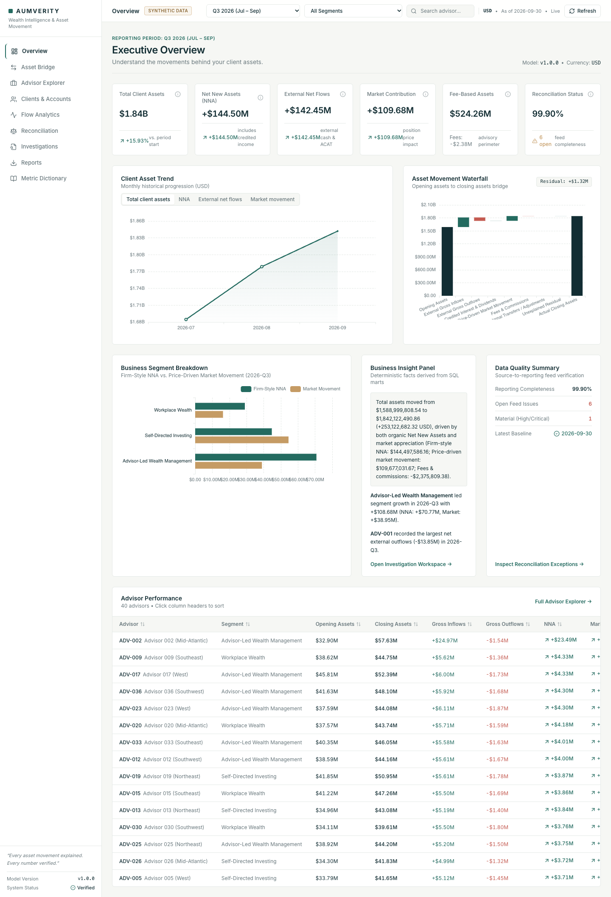
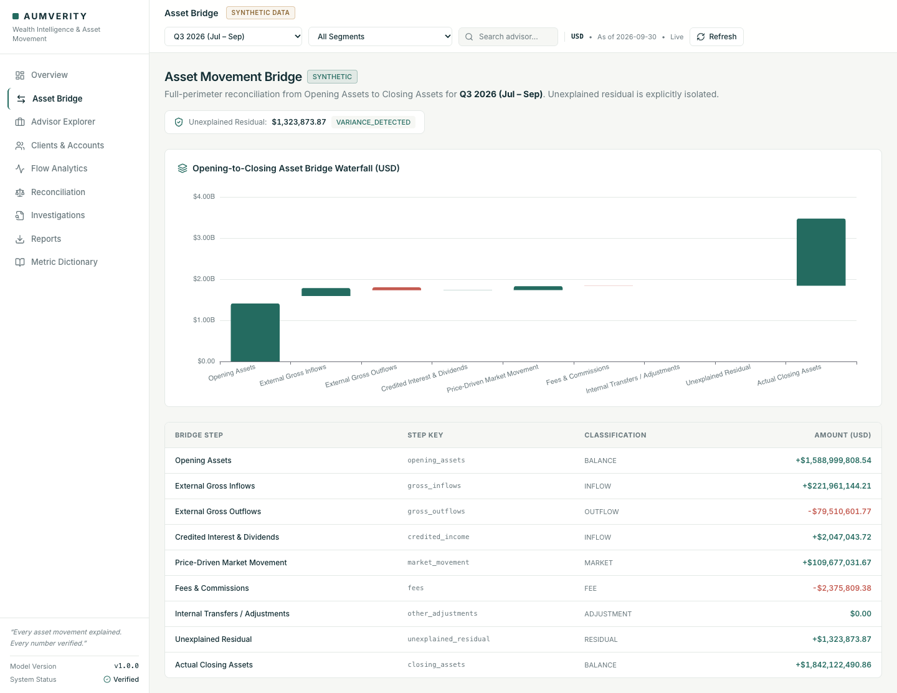
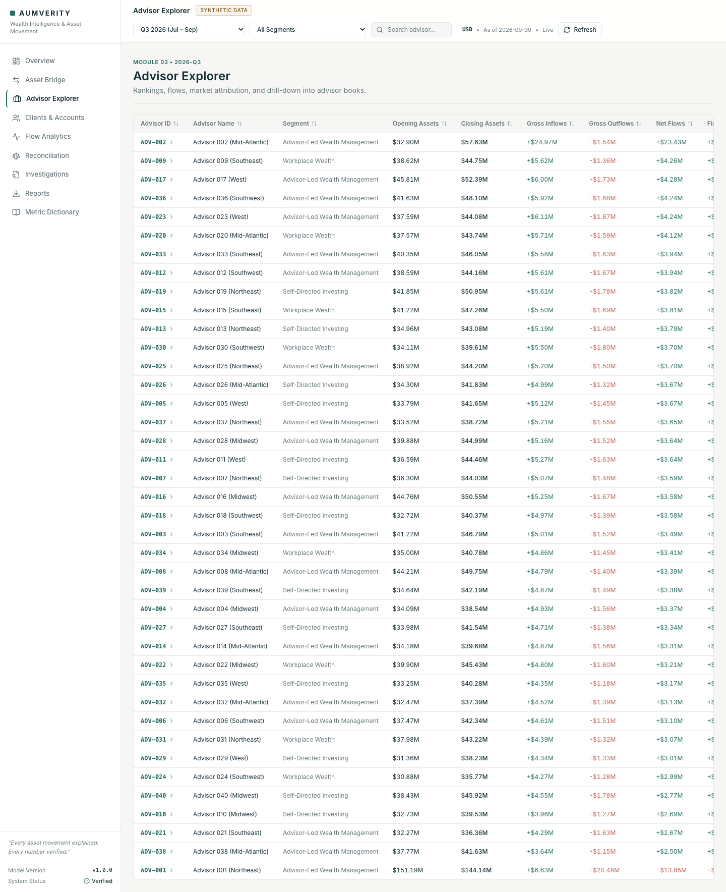
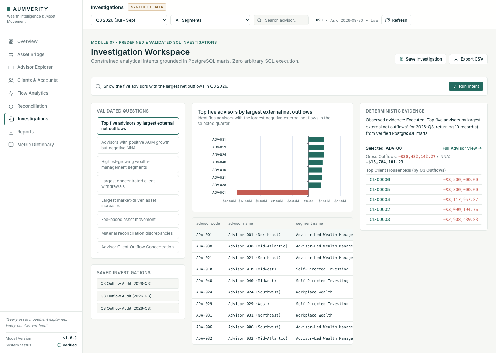
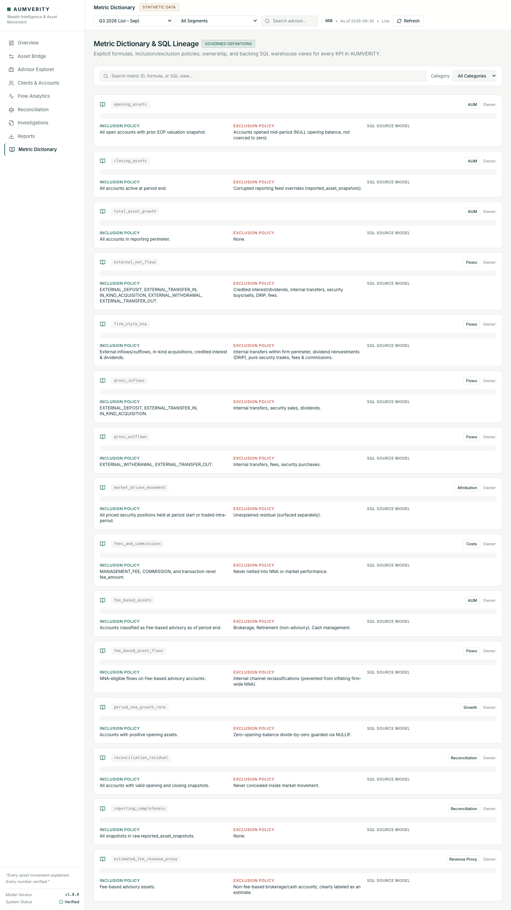
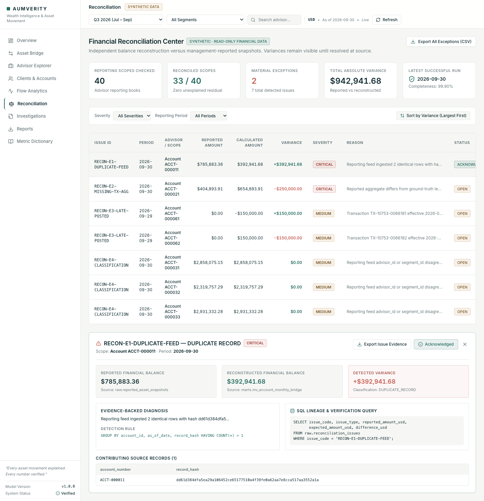
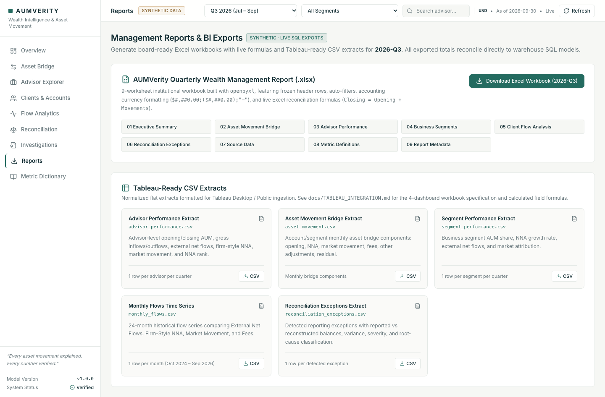
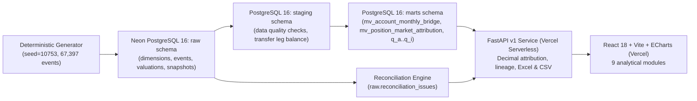

# AUMVERITY — Wealth Intelligence & Asset Movement Analytics

> **"Every asset movement explained. Every number verified."**

[](https://aumverity.vercel.app)
[](https://aumverity-api.vercel.app/api/v1/health)
[](https://neon.tech)
[](LICENSE)

🌐 **Live Application:** **[https://aumverity.vercel.app](https://aumverity.vercel.app)**  
📡 **Live API (FastAPI):** **[https://aumverity-api.vercel.app](https://aumverity-api.vercel.app)**  
📁 **GitHub Repository:** **[https://github.com/shaaunak/aumverity-wealth-analytics](https://github.com/shaaunak/aumverity-wealth-analytics)**  

> **Disclosure:** All clients, advisors, accounts, transactions, prices, and balances in AUMVERITY are **100% SYNTHETIC** (`--profile demo --seed 10753`). This is an independent portfolio project and is not affiliated with any financial institution.

---

## 1. Project Introduction
**AUMVERITY** is an internal wealth management analytics and reconciliation platform designed to answer *why* client assets under management (AUM) changed over any reporting period. Every figure is backed by traceable PostgreSQL calculations, line-item transaction drill-downs, and automated balance tie-outs.

---

## 2. Live Application Screenshots

All screenshots below are captured from the live deployment running against managed PostgreSQL on Neon:

### Executive Overview & Explainable KPI Lineage


### Opening-to-Closing Asset Movement Bridge


### Advisor Explorer & Drill-Down Scorecards


### Investigation Workspace (Predefined Template Execution)


### Governed Metric Dictionary & SQL Lineage


### Financial Reconciliation Center (Reported vs. Reconstructed Balance)


### Management Reports & Live Excel / Tableau CSV Exports


---

## 3. Business Problem & Why It Matters
In institutional wealth management, leadership routinely asks:
* *"Did client assets grow because our advisors brought in net new money, or because equity markets rallied?"*
* *"Which advisors are suffering from quiet client attrition masked by strong market performance?"*
* *"Why does our management summary diverge by \$250,000 from the transaction ledger?"*

Standard business intelligence dashboards frequently fail because:
1. **Internal book transfers are counted as new inflows**, artificially inflating gross sales.
2. **Market appreciation is treated as a balancing plug** (`Closing - Opening - Flows`), silently burying missing transactions, feed drops, and valuation errors.
3. **External Net Flows are conflated with Firm-Style Net New Assets (NNA)**, obscuring organic advisor acquisition metrics.

AUMVERITY solves this by enforcing an auditable financial bridge with an explicit **Unexplained Residual** metric that can never be swept under market movement.

---

## 4. Core Features & Analytical Modules

1. **Executive Overview (`/`)**: Headline KPIs (AUM, Growth %, Firm-Style NNA, External Net Flows, Market Movement, Fee Drag), clickable Explainable KPI drawers, and segment attribution.
2. **Asset Movement Bridge (`/bridge`)**: Waterfall chart decomposing Beginning AUM to Ending AUM with zero unexplained residual on clean data.
3. **Advisor Explorer (`/advisors`, `/advisors/:id`)**: Sortable scorecards across 40 advisors, outflow/NNA rankings, client household concentration, and account distribution.
4. **Client & Account Explorer (`/clients`, `/clients/:id`)**: Hierarchical drill-down from advisor to household/client down to individual account cash/equity valuations and transaction legs.
5. **Flow & Period Compare Analytics (`/flows`)**: Quarter-over-quarter comparison (`2026-Q3` vs `2026-Q2`), advisor rank movement, External Net Flows vs. Firm-Style NNA trends, and **Positive AUM Growth / Negative NNA** detection.
6. **Financial Reconciliation Center (`/reconciliation`)**: Automated detection of duplicate records, missing aggregates, late-posted boundary transfers, and classification mismatches with interactive **Reported vs. Reconstructed** balance comparisons.
7. **Investigation Workspace (`/investigations`)**: Parameterized SQL execution templates (no arbitrary SQL injection risk) with saved investigation logs.
8. **Metric Dictionary & Lineage (`/lineage`)**: Governed metric registry with mathematical formulas, inclusion/exclusion rules, owners, and SQL views.
9. **Management Reports & BI Exports (`/exports`)**: 9-worksheet `openpyxl` Excel report with live `=` formulas and 5 Tableau-ready CSV extracts.

---

## 5. System Architecture


---

## 6. Technology Stack
- **Frontend:** React 18, TypeScript, Vite, Tailwind CSS, TanStack Query v5, TanStack Table v8, Apache ECharts, Lucide React.
- **Backend & APIs:** Python 3.12+, FastAPI, Pydantic v2, `openpyxl`, `psycopg` 3 (binary), SQLAlchemy 2.
- **Database & Warehouse:** Managed PostgreSQL on Neon, Alembic migrations, Materialized Views, covering B-tree indexes (`INCLUDE`).
- **Testing & Tooling:** Pytest, Vitest, Playwright E2E, Ruff linter, Vercel CLI.

---

## 7. Financial Methodology

$$\text{Closing Assets} = \text{Opening Assets} + \text{Firm-Style NNA} + \text{Market Movement} - \text{Fees \& Commissions} + \text{Other Adjustments} + \text{Unexplained Residual}$$

* **Metric 1 — External Net Flows:** `External Deposits + External Transfers In + External In-Kind Received - External Withdrawals - External Transfers Out`.
* **Metric 2 — Firm-Style Net New Assets (NNA):** Eligible inflows + credited interest/dividends + eligible acquisitions − eligible outflows (excluding internal transfers within the reporting perimeter, fees, and pure security trading).
* **Dividend Reinvestment:** Credited cash dividends enter cash once; reinvesting that cash into a security is a cash-for-security trade (`NNA = $0.00`), preventing double-counting.
* **Unexplained Residual:** `Actual Closing Assets - Expected Closing Assets`. Derived independently from classified events and position valuations; never hidden inside market movement.

---

## 8. PostgreSQL Warehouse Structure & SQL Models

The warehouse is strictly partitioned into distinct schemas:
* `raw`: Immutable source/synthetic tables (`advisors`, `clients`, `accounts`, `transaction_events`, `transaction_legs`, `position_snapshots`, `security_prices`, `account_valuations`, `reported_asset_snapshots`, `reconciliation_issues`).
* `staging`: Data-quality views (`stg_transaction_legs`, `stg_account_valuations`) verifying `SUM(CREDIT - DEBIT) = 0` on internal transfer groups and `cash + securities = total_equity`.
* `marts`: High-performance analytical materialized views (`mv_account_monthly_bridge`, `mv_position_market_attribution`) and 9 Business Question views (`q_a_top5_outflow_advisors_q3_2026` through `q_i_unreconciled_reported_accounts`).

### Performance Optimization Case Study
In [docs/SQL_OPTIMIZATION_CASE_STUDY.md](docs/SQL_OPTIMIZATION_CASE_STUDY.md), benchmarked via PostgreSQL `EXPLAIN (ANALYZE, BUFFERS)`:
* **Before:** Raw multi-table join executed in **143.589 ms** with an external disk sort using **2744 kB** of temporary disk space.
* **After:** Indexed materialized view `marts.mv_account_monthly_bridge` with covering index `ix_mv_acct_bridge_end_date` executed in **61.639 ms** via `Index Only Scan` (**0** heap fetches, **0** temporary disk blocks).

---

## 9. Local Installation & Development

### Prerequisites
- Python 3.12+
- Node.js 20+ and npm
- PostgreSQL 16 (or Neon managed connection string)

### 1. Clone & Setup
```bash
git clone https://github.com/shaaunak/aumverity-wealth-analytics.git
cd aumverity-wealth-analytics
cp .env.example .env
```

### 2. Backend Setup
```bash
python3 -m venv .venv
source .venv/bin/activate
pip install -r backend/requirements.txt
```

### 3. Frontend Setup
```bash
cd frontend
npm install
cd ..
```

### 4. Run Migrations & Seed Synthetic Dataset
```bash
alembic -c backend/alembic.ini upgrade head
python -m data.generator --profile demo --seed 10753
```

### 5. Start Development Servers
```bash
make dev
# Frontend: http://localhost:5173
# Backend: http://localhost:8000 (API Docs at /docs)
```

---

## 10. Automated Test Suite

```bash
# Run backend unit, integration, attribution regression, and DQ tests (35 passed)
.venv/bin/pytest -v

# Run frontend typecheck, Vitest unit tests, and production build
cd frontend && npm run typecheck && npm run test && npm run build

# Run Playwright End-to-End audit across all 9 routes
cd frontend && npm run test:e2e
```

---

## 11. Three-Minute Stakeholder Demo Walkthrough
See [docs/DEMO_SCRIPT.md](docs/DEMO_SCRIPT.md) for the structured presentation flow:
1. **0:00 - 0:35**: Executive Overview, synthetic data badge, and clicking **Firm-Style NNA** to review its SQL lineage CTEs.
2. **0:35 - 1:15**: Asset Movement Bridge waterfall, demonstrating \$0.00 unexplained variance on clean books.
3. **1:15 - 2:00**: Advisor Explorer & Flows, identifying `ADV-001` (concentrated client departures) vs `ADV-002` (broad-based organic growth).
4. **2:00 - 2:35**: Reconciliation Center, drilling into detected discrepancies (`DUPLICATE_RECORD`, `MISSING_TRANSACTION_AGGREGATE`, `LATE_POSTED_TRANSFER`, `CLASSIFICATION_MISMATCH`) and exporting evidence CSVs.
5. **2:35 - 3:00**: Management Reports, downloading the 9-sheet Excel workbook and Tableau CSV extracts.

---

## 12. License
MIT License. Created by Shaaunak Pitale for portfolio and technical demonstration purposes.
